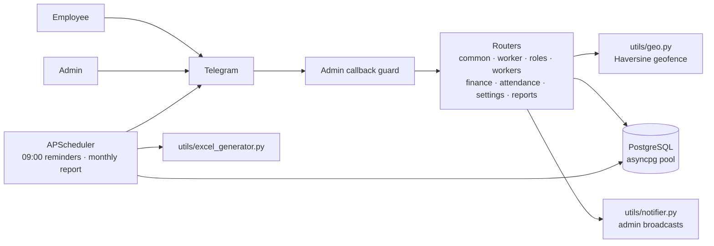

# 🕒 Smena — Restaurant Staff Bot

**English** · [O'zbekcha](README.uz.md)

[](https://xoliddev.github.io/demos/smena-staff-bot/)

> *Smena* means "shift". A Telegram back-office bot for restaurants and cafés: geofenced check-in/out,
> advances, payroll and a monthly Excel timesheet.


Smena replaces the paper attendance sheet and the "who got how much advance" notebook of a restaurant:
employees check in and out by sharing their location (validated against a geofence around the workplace),
managers hand out advances and final settlements with two-step confirmation, every money movement is instantly
reported to all admins, and a monthly Excel timesheet with payroll balances is generated automatically.

The bot is **white-label**: set `RESTAURANT_NAME` in `.env` and that name is used in every greeting,
notification, report caption, Excel title and file name. Bot texts are in Uzbek (Latin).

## ✨ Features

### 👷 For employees
- **Job application flow** — `/start` → full name → phone (typed or shared contact) → role picked from the
  current list of roles; admins approve or reject with one tap and the applicant is notified.
- **🟢 Check in / 🔴 Check out** — the bot asks for the current location and checks it against the
  workplace coordinates with the Haversine formula; outside the radius the check-in is refused with the exact distance.
- **🌙 Day off** marking, **📊 My report** (days, hours, earned, advances, balance for the month),
  **👤 Profile**, **📞 Contact** the management.
- **Morning reminder** at 09:00 for anyone who has not checked in yet. Open shifts are never auto-closed, so
  late-night staff are not cut off.

### 🧑‍💼 For admins
- **Dynamic roles (CRUD)** — no hard-coded positions; create, rename or delete roles (Cook, Waiter, Cashier,
  Grill cook…) right from the bot.
- **Staff directory** — two-column inline grid with pagination, filter by role, search by name, and a profile
  card with salary, today's attendance, hours this month, advances and remaining balance.
- **Salary models** — monthly salary (daily rate = salary / 26 working days) or daily rate.
- **💵 Advances & 💳 settlements** — pick an employee, enter amount and note, confirm; transactions can be
  cancelled with a confirmation step.
- **🔔 Real-time notifications** — every advance/settlement is broadcast to all admins and super admins: who,
  how much, when, and which admin paid.
- **⏰ Today's attendance** — overview of who is at work, who is resting and who is absent.
- **⚙️ Settings** — set the workplace by simply sending a Telegram location, choose the radius
  (50–500 m), manage admins, the contact shown to staff, and a log group for attendance/payment events.
- **📊 Excel reports** — monthly timesheet plus payroll summary (`openpyxl`); also sent automatically to all
  admins (and the log group) on the 1st of every month.

### 🏷 White-label
- One env var, `RESTAURANT_NAME` (default `Smena`), brands the whole bot: welcome screens, the admin panel
  header, approval messages, attendance notifications, report captions, the Excel title row and the report
  file name (e.g. `Grill_House_Mart_2026_Hisoboti.xlsx`).
- No code changes are needed to run the same bot for another restaurant — just a separate `.env` and database.

### 🔐 Access model
Super admins come from `.env`; regular admins are added from the bot and stored in the DB. Every admin
callback is re-checked server-side by a middleware, so a forwarded or stale button grants nothing.

## 🏗 Architecture



```
smena-staff-bot/
├── bot.py                    entry point: DB pool, routers, scheduler, polling
├── config.py                 settings from .env (incl. RESTAURANT_NAME), formatting helpers
├── loader.py                 Bot and Dispatcher instances
├── database.py               asyncpg pool, schema bootstrap/migrations, all queries
├── states.py                 aiogram FSM states
├── handlers/
│   ├── common.py             /start, job applications
│   ├── worker_handlers.py    check in / check out / day off, personal report
│   ├── admin_roles.py        roles CRUD
│   ├── admin_workers.py      staff grid, search, profiles, applications
│   ├── admin_finance.py      advances and settlements
│   ├── admin_attendance.py   today's attendance
│   ├── admin_settings.py     location, radius, admins, contact, log group
│   └── reports.py            Excel exports
├── keyboards/                inline and reply keyboards
├── utils/                    geo, notifier, excel generator, scheduler, middlewares, UI helpers
├── tests/                    unit tests (geofence, formatting, white-label config, Excel title)
├── Dockerfile · docker-compose.yml · smena-bot.service
└── DEPLOYMENT.md             step-by-step VPS guide (Uzbek)
```

Tables (`roles`, `workers`, `work_sessions`, `finance_transactions`, `job_applications`, `admins`, `settings`)
are created automatically on start-up.

## 🚀 Quick start

### 1. Configure

```bash
git clone https://github.com/xoliddev/smena-staff-bot.git
cd smena-staff-bot
cp .env.example .env
```

| Variable | Required | Default | Description |
|---|---|---|---|
| `BOT_TOKEN` | ✅ | — | Bot token from [@BotFather](https://t.me/BotFather) |
| `SUPERADMINS` | ✅ | — | Comma-separated Telegram user ids of super admins |
| `RESTAURANT_NAME` | | `Smena` | Restaurant / business name shown in bot texts, notifications and Excel reports |
| `DATABASE_URL` | | *(empty)* | Full `postgresql://…` URL; when set it overrides the `POSTGRES_*` variables |
| `POSTGRES_USER` | | `postgres` | DB user |
| `POSTGRES_PASSWORD` | ✅ (Docker) | — | DB password |
| `POSTGRES_DB` | | `smena_db` | DB name |
| `POSTGRES_HOST` | | `localhost` | DB host (`postgres` inside docker-compose) |
| `POSTGRES_PORT` | | `5432` | DB port |
| `DEFAULT_LAT` / `DEFAULT_LON` | | Tashkent centre | Initial workplace coordinates (changeable from the bot) |
| `DEFAULT_RADIUS` | | `150` | Initial check-in radius, meters |
| `WORK_LOG_GROUP_ID` | | `0` | Log group id (the active value is set from the bot's Settings) |

### 2. Docker Compose (bot + PostgreSQL)

```bash
docker compose up -d --build
docker compose logs -f bot
```

PostgreSQL is published on `127.0.0.1` only and data lives in the `pgdata` volume.

### 3. Run locally

Requires Python 3.11+ and a running PostgreSQL.

```bash
python -m venv .venv
# Windows: .venv\Scripts\activate    Linux/macOS: source .venv/bin/activate
pip install -r requirements.txt
python bot.py
```

For a bare-metal VPS with systemd, nightly `pg_dump` backups and a post-launch checklist, see
[DEPLOYMENT.md](DEPLOYMENT.md).

## 🧪 Tests

```bash
pip install -r requirements-dev.txt
python -m pytest -q
```

The same suite runs on every push and pull request via GitHub Actions (Python 3.12, dummy env values only).

## 📄 License

[MIT](LICENSE) © 2026 xoliddev
