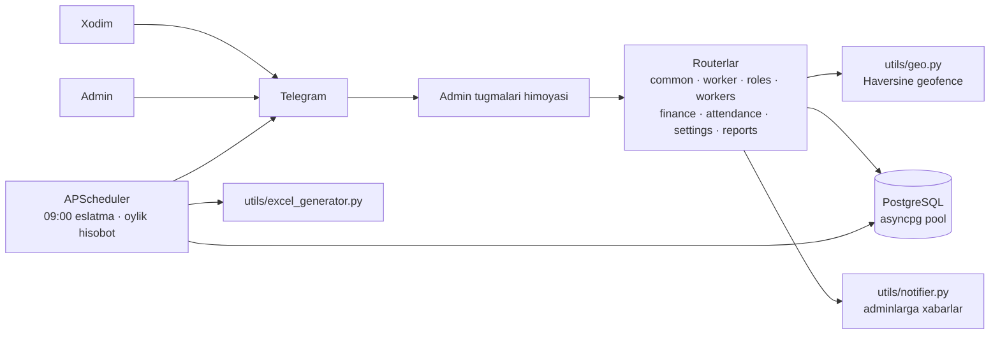

# 🕒 Smena — restoran xodimlari uchun bot

[English](README.md) · **O'zbekcha**

[](https://xoliddev.github.io/demos/smena-staff-bot/)

> *Smena* — ish navbati. Restoran va kafelar uchun Telegram bot: geolokatsiya orqali keldi-ketdi,
> avans, ish haqi hisob-kitobi va oylik Excel tabel.

[](https://github.com/xoliddev/smena-staff-bot/actions/workflows/tests.yml)


Smena restorandagi qog'oz davomat daftari va "kimga qancha avans berildi" yozuvlarini almashtiradi.
Xodimlar ishga kelganda va ketganda joylashuvini yuboradi — bot uni ish joyi atrofidagi radius bilan
solishtiradi. Menejerlar avans va oylik hisob-kitobni ikki bosqichli tasdiq bilan beradi, har bir pul
harakati darhol barcha adminlarga xabar qilinadi, oy oxirida esa ish haqi qoldiqlari bilan Excel tabel
avtomatik tayyorlanadi.

Bot **white-label**: `.env` faylida `RESTAURANT_NAME` ni yozasiz — shu nom barcha salomlashuv
xabarlarida, bildirishnomalarda, hisobot izohlarida, Excel sarlavhasi va fayl nomida chiqadi.
Bot matnlari o'zbek tilida (lotin).

## ✨ Imkoniyatlar

### 👷 Xodimlar uchun
- **Ishga ariza** — `/start` → ism-familiya → telefon (qo'lda yoki kontakt ulashib) → lavozimni ro'yxatdan
  tanlash; admin bir bosishda tasdiqlaydi yoki rad etadi, arizachiga xabar boradi.
- **🟢 Ishga keldim / 🔴 Ishdan ketdim** — bot joriy joylashuvni so'raydi va Haversine formulasi bilan ish
  joyi koordinatalariga solishtiradi; radiusdan tashqarida bo'lsa, aniq masofani ko'rsatib rad etadi.
- **🌙 Dam olish kuni** belgilash, **📊 Mening hisobotim** (oy bo'yicha kunlar, soatlar, hisoblangan
  maosh, avanslar, qoldiq), **👤 Profil**, **📞 Ma'muriyat bilan bog'lanish**.
- **Ertalabki eslatma** — soat 09:00 da hali kelmaganlarga eslatma yuboriladi. Ochiq smenalar avtomatik
  yopilmaydi, shuning uchun kechgacha ishlaydiganlar uzilib qolmaydi.

### 🧑‍💼 Adminlar uchun
- **Dinamik lavozimlar (CRUD)** — lavozimlar kodga qotirilmagan; oshpaz, ofitsiant, kassir, mangalchi va
  boshqalarni botning o'zida qo'shish, nomini o'zgartirish yoki o'chirish mumkin.
- **Xodimlar ro'yxati** — sahifalangan ikki ustunli tugmalar, lavozim bo'yicha filtr, ism bo'yicha qidiruv va
  profil kartasi: maosh, bugungi davomat, oy davomidagi soatlar, avanslar va qolgan summa.
- **Maosh turlari** — oylik maosh (kunlik stavka = maosh / 26 ish kuni) yoki kunlik stavka.
- **💵 Avans va 💳 hisob-kitob** — xodimni tanlang, summa va izohni kiriting, tasdiqlang; to'lovni tasdiq
  bilan bekor qilish ham mumkin.
- **🔔 Jonli bildirishnomalar** — har bir avans yoki hisob-kitob barcha admin va superadminlarga yuboriladi:
  kimga, qancha, qachon va qaysi admin bergani.
- **⏰ Bugungi davomat** — kim ishda, kim dam olmoqda, kim kelmagani bir qarashda.
- **⚙️ Sozlamalar** — ish joyini Telegram lokatsiyasini yuborib belgilash, radiusni tanlash (50–500 m),
  adminlarni boshqarish, xodimlarga ko'rinadigan aloqa kontakti va davomat/to'lov loglari uchun guruh.
- **📊 Excel hisobotlar** — oylik davomat tabeli va ish haqi yig'masi (`openpyxl`); har oyning 1-kunida
  barcha adminlarga (va log guruhiga) avtomatik yuboriladi.

### 🏷 White-label
- Bitta muhit o'zgaruvchisi — `RESTAURANT_NAME` (standart qiymati `Smena`) — butun botni brendlaydi:
  salomlashuv ekranlari, admin panel sarlavhasi, ariza tasdiqlangani haqidagi xabar, davomat
  bildirishnomalari, hisobot izohlari, Excel sarlavha qatori va fayl nomi
  (masalan, `Grill_House_Mart_2026_Hisoboti.xlsx`).
- Shu botni boshqa restoran uchun ishga tushirishda kodni o'zgartirish shart emas — alohida `.env` va
  alohida ma'lumotlar bazasi kifoya.

### 🔐 Kirish huquqlari
Superadminlar `.env` dan olinadi; oddiy adminlar botning o'zidan qo'shiladi va bazada saqlanadi. Har bir
admin tugmasi server tomonida middleware orqali qayta tekshiriladi, shuning uchun forward qilingan yoki
eskirgan tugma hech qanday huquq bermaydi.

## 🏗 Arxitektura



```
smena-staff-bot/
├── bot.py                    kirish nuqtasi: DB pool, routerlar, scheduler, polling
├── config.py                 .env sozlamalari (RESTAURANT_NAME ham), formatlash yordamchilari
├── loader.py                 Bot va Dispatcher obyektlari
├── database.py               asyncpg pool, jadvallarni yaratish/migratsiya, barcha so'rovlar
├── states.py                 aiogram FSM holatlari
├── handlers/
│   ├── common.py             /start, ishga arizalar
│   ├── worker_handlers.py    keldi / ketdi / dam olish, shaxsiy hisobot
│   ├── admin_roles.py        lavozimlar CRUD
│   ├── admin_workers.py      xodimlar ro'yxati, qidiruv, profillar, arizalar
│   ├── admin_finance.py      avans va hisob-kitoblar
│   ├── admin_attendance.py   bugungi davomat
│   ├── admin_settings.py     lokatsiya, radius, adminlar, kontakt, log guruhi
│   └── reports.py            Excel eksport
├── keyboards/                inline va reply klaviaturalar
├── utils/                    geo, notifier, excel generator, scheduler, middleware, UI yordamchilari
├── tests/                    unit testlar (geofence, formatlash, white-label sozlamasi, Excel sarlavhasi)
├── Dockerfile · docker-compose.yml · smena-bot.service
└── DEPLOYMENT.md             VPS ga o'rnatish bo'yicha qadamma-qadam qo'llanma
```

Jadvallar (`roles`, `workers`, `work_sessions`, `finance_transactions`, `job_applications`, `admins`,
`settings`) bot ishga tushganda avtomatik yaratiladi.

## 🚀 Tez boshlash

### 1. Sozlash

```bash
git clone https://github.com/xoliddev/smena-staff-bot.git
cd smena-staff-bot
cp .env.example .env
```

| O'zgaruvchi | Majburiy | Standart | Tavsif |
|---|---|---|---|
| `BOT_TOKEN` | ✅ | — | [@BotFather](https://t.me/BotFather) dan olingan token |
| `SUPERADMINS` | ✅ | — | Superadminlarning Telegram ID lari, vergul bilan |
| `RESTAURANT_NAME` | | `Smena` | Bot matnlari, bildirishnomalar va Excel hisobotlarida chiqadigan restoran nomi |
| `DATABASE_URL` | | *(bo'sh)* | To'liq `postgresql://…` manzil; berilsa `POSTGRES_*` o'zgaruvchilari o'rniga ishlatiladi |
| `POSTGRES_USER` | | `postgres` | Baza foydalanuvchisi |
| `POSTGRES_PASSWORD` | ✅ (Docker) | — | Baza paroli |
| `POSTGRES_DB` | | `smena_db` | Baza nomi |
| `POSTGRES_HOST` | | `localhost` | Baza manzili (docker-compose ichida `postgres`) |
| `POSTGRES_PORT` | | `5432` | Baza porti |
| `DEFAULT_LAT` / `DEFAULT_LON` | | Toshkent markazi | Ish joyining boshlang'ich koordinatalari (botdan o'zgartiriladi) |
| `DEFAULT_RADIUS` | | `150` | Boshlang'ich ruxsat radiusi, metr |
| `WORK_LOG_GROUP_ID` | | `0` | Log guruhi ID si (amaldagi qiymat bot sozlamalaridan beriladi) |

### 2. Docker Compose (bot + PostgreSQL)

```bash
docker compose up -d --build
docker compose logs -f bot
```

PostgreSQL faqat `127.0.0.1` da ochiladi, ma'lumotlar `pgdata` volume'ida saqlanadi.

### 3. Kompyuterda ishga tushirish

Python 3.11+ va ishlab turgan PostgreSQL kerak.

```bash
python -m venv .venv
# Windows: .venv\Scripts\activate    Linux/macOS: source .venv/bin/activate
pip install -r requirements.txt
python bot.py
```

systemd bilan oddiy VPS ga o'rnatish, har kechasi `pg_dump` zaxira nusxasi va ishga tushirgandan keyingi
tekshiruv ro'yxati uchun [DEPLOYMENT.md](DEPLOYMENT.md) ga qarang.

## 🧪 Testlar

```bash
pip install -r requirements-dev.txt
python -m pytest -q
```

Shu testlar har bir push va pull request da GitHub Actions orqali ishga tushadi (Python 3.12, faqat
soxta muhit qiymatlari bilan).

## 📄 Litsenziya

[MIT](LICENSE) © 2026 xoliddev
